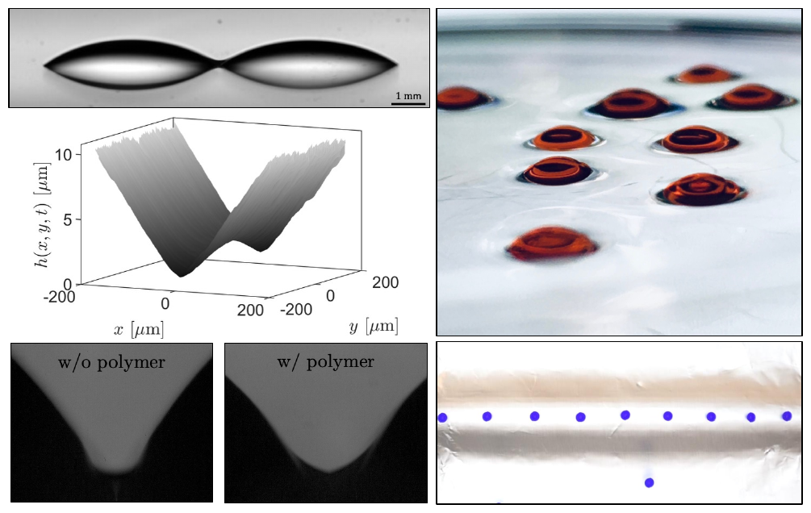
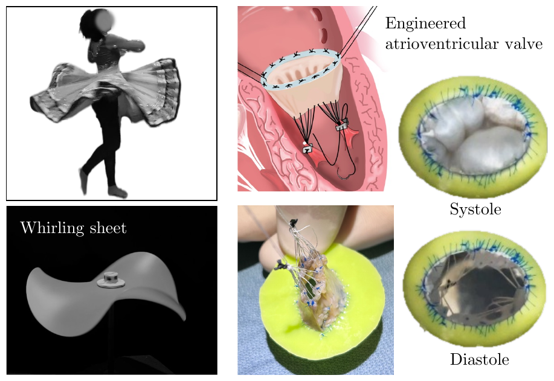

My research has mainly spanned three types of interfaces across a wide range of time and length scales and across fields.

<!-- Each "##" line is a section heading. -->

## Fluid interfaces

**How do two drops become one?** I used high-speed optical measurements and mathematical models to show that viscous drops merge in a remarkably coordinated, three-dimensional way. Add polymers, though, and the tiny “neck” joining the drops can change shape and behavior.

**Can two liquids keep their lanes?** In microchannels, flows that look perfectly orderly can suddenly lose their symmetry near an exit—making it harder to separate the liquids cleanly. Surfactants and the balance between viscosity and surface tension can also decide whether a moving fluid front stays smooth or sprouts fingers. Fluids, it turns out, don’t always follow the lane markings.

**Can drops be guided without touching them -- drop bending?** I developed a way to move water drops across an oil–air surface using electric forces. The drops can find preferred positions, repel one another, and even arrange themselves into shifting patterns. Changing the thickness of the oil layer helps control their spacing and motion. The work also led to a patent application.

{: .research-fig }

**Related publications**

- **P. R. Kaneelil**, A. A. Pahlavan, N. Xue, H. A. Stone, “Three-dimensional self-similarity of coalescing viscous drops in the thin-film regime”, *Physical Review Letters*, 129, 144501 (2022).
- **P. R. Kaneelil**, K. Tojo, P. Kumar Farsoiya, L. Deike, H. A. Stone, “Coalescence of viscoelastic sessile drops: the small and large contact angle limits”, *Journal of Fluid Mechanics*, 1026, A12 (2026).
- **P. R. Kaneelil**, A. A. Pahlavan, M. A. Herrada, K. LeRoy, K. Stengel, S. Warner, A. M. Galea, H. A. Stone, “Symmetry breaking of a parallel two-phase flow in a finite length channel”, *Physical Review Fluids*, 7, 033904 (2022).
- M. A. Herrada, A. Ponce-Torres, **P. R. Kaneelil**, A. A. Pahlavan, H. A. Stone, J. M. Montanero, “Effect of a soluble surfactant on the linear stability of two-phase flows in a finite-length channel”, *Physical Review Fluids*, 7, 114003 (2022).
- S. McBride, F. Temprano-Coleto, **P. R. Kaneelil**, et al., “Effect of capillary number and viscosity ratio on multiphase displacement in microscale pores”, *Physical Review Fluids*, 10 (5), 054201 (2025).
- **P. R. Kaneelil**, J. P. de Souza, G. Turk, A. A. Pahlavan, H. A. Stone, “Electrically mediated self-assembly and manipulation of drops at an interface”, *Soft Matter*, 20 (27), 5417-5424 (2024). [Invited article in the *Soft Matter Electrified* themed collection]

## Elastic interfaces

**What patterns form on a spinning soft sheet?** Drawing inspiration from the patterns on a dancer's skirt as they spin, we set out to uncover the patterns on a spinning soft sheet. It can do more than simply flatten out. As the spin speed increases, a soft sheet moves through three distinct shapes—from gravity-draped to centrifugally flattened to a dramatic whirling state. In that final state, ripples travel backward even as the sheet spins forward. We mapped when each behavior appears and developed rules to predict the transitions.

**Can a heart valve be designed by a set of rules?** Working with surgeons at Boston Children’s Hospital, we developed an engineering approach to building living heart valves from donor tissue and artificial cords. Instead of designing just one valve, we identified a small set of key proportions that shape how a valve works. We tested possible designs in the lab and validated a promising configuration in a large-animal study.

{: .research-fig }

**Related publications**

- S. Yin, **P. R. Kaneelil**, L. Mahadevan, “Elastohydrodynamic instability of a spinning elastic disk”, *Journal of Fluid Mechanics* (under review), [[arXiv:2607.19561](https://arxiv.org/abs/2607.19561)].

## Active interfaces

*Coming soon.*
